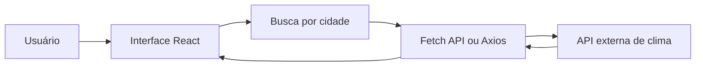

# Dashboard de Monitoramento de Clima

MVP planejado de um dashboard web responsivo para pesquisar cidades e visualizar condições meteorológicas. A interface será construída em React e Tailwind CSS e consultará uma API externa de clima.

## Status do Projeto

O repositório está na etapa de planejamento e configuração. A interface, a integração com a API e os testes automatizados ainda não foram implementados. Por isso, os comandos de execução descritos abaixo são o fluxo pretendido e a aplicação ainda não pode ser iniciada.

## Funcionalidades Planejadas

- Pesquisar uma cidade pelo nome;
- Exibir temperatura em °C, umidade, sensação térmica, ícone e descrição do clima;
- Apresentar previsão de curto prazo;
- Informar quando uma cidade não for encontrada ou a API estiver indisponível;
- Adaptar a interface para desktop e dispositivos móveis.

Autenticação, histórico persistido, banco de dados e outros serviços além da API de clima não fazem parte do MVP atual.

## Tecnologias e Ferramentas

- React 19.3.1 e React DOM 19.3.1;
- Tailwind CSS 4.3.3;
- Vite 8.3.4 para desenvolvimento e build;
- Axios 1.20.0 como cliente HTTP instalado. O Fetch API também é uma alternativa nativa do navegador e não requer dependência adicional;
- API de clima: OpenWeatherMap é uma opção considerada, mas ainda não configurada;
- Assistente de código: GitHub Copilot;
- Modelo de IA utilizado: ainda não registrado para este projeto. Registrar o nome do modelo e a atividade correspondente quando forem definidos.
- Testes: framework e bibliotecas ainda não configurados.

As versões das dependências diretas estão declaradas em [`../package.json`](../package.json).

## Configuração e Execução Local

### Pré-requisitos

- Git;
- Node.js compatível com Vite 8 (Node.js 20.19+ ou 22.12+);
- npm, incluído na instalação do Node.js.

### Instalação

Na raiz do repositório, execute:

```bash
npm install
```

### Iniciar em desenvolvimento

```bash
npm run dev
```

O script Vite está declarado, mas a inicialização depende da implementação do ponto de entrada da aplicação (`index.html` e código em `src/`), que ainda não existe. Portanto, este comando não é executável com o estado atual do repositório.

Quando a aplicação for implementada, uma chave de API poderá ser configurada localmente em `.env.local`, por exemplo:

```env
VITE_WEATHER_API_KEY=sua_chave
```

Não versione chaves reais. Variáveis com prefixo `VITE_` são incorporadas ao frontend e ficam visíveis no navegador; não use esse mecanismo para segredos que precisem permanecer privados.

### Build de produção

O script planejado é:

```bash
npm run build
```

Ele também depende da criação do ponto de entrada e dos arquivos da aplicação.

## Como Interagir

Ainda não há uma interface ou API implementada para uso real. O fluxo esperado para o MVP é:

1. Digitar o nome de uma cidade, por exemplo, `Curitiba`;
2. Solicitar a consulta;
3. Visualizar as condições atuais e a previsão disponíveis;
4. Receber uma mensagem clara caso a cidade não seja encontrada ou a consulta falhe.

## Arquitetura Prevista

O escopo atual prevê uma aplicação frontend que consulta diretamente o serviço meteorológico. Backend, PostgreSQL e persistência não fazem parte desta versão.



## Testes Automatizados

Ainda não há testes, framework de testes ou script `test` no `package.json`. Assim, não existe um comando de teste executável nem resultados de aprovação a relatar neste estágio. Antes da entrega do MVP, devem ser adicionados testes unitários e de integração para busca, estados de carregamento, renderização dos dados e erros da API, além de um comando de teste documentado e validado.

## Limitações e Próximos Passos

- Criar o ponto de entrada e os componentes React;
- Escolher e integrar uma API meteorológica, incluindo o tratamento seguro da chave;
- Implementar busca, previsão, estados de carregamento e mensagens de erro;
- Configurar testes automatizados e verificar build e testes em ambiente limpo;
- Gerar e versionar o lockfile npm para fixar também as dependências transitivas;
- Revisar acessibilidade e comportamento responsivo;
- Definir créditos finais e uma licença para o projeto.

## Créditos e Licença

OpenWeatherMap é uma API candidata, ainda não integrada. Os créditos de autoria e a licença do repositório ainda não foram definidos; não reutilize ou redistribua o projeto sob uma licença presumida.

## Releases e Tags

Ainda não há release ou tag publicada. Após implementar o MVP, executar e aprovar os testes e revisar a documentação, recomenda-se criar uma release e uma tag versionada, por exemplo `v1.0.0`.