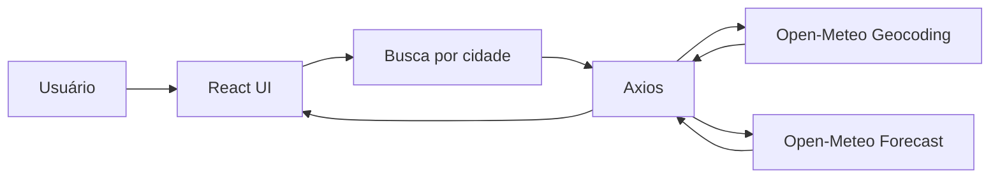

# Dashboard de Monitoramento de Clima

MVP web responsivo para pesquisar cidades e acompanhar condições meteorológicas atuais e previsão para os próximos dias. A interface foi implementada em React e Tailwind CSS e consome os serviços públicos do Open-Meteo.

## Funcionalidades

- Consulta inicial de Curitiba e busca de outras cidades;
- Temperatura atual, sensação térmica, umidade, vento e chance de chuva;
- Previsão diária para cinco dias, com máximas e mínimas;
- Estados de carregamento, cidade não encontrada e falha de conexão;
- Layout responsivo para desktop e dispositivos móveis.

## Tecnologias e Ferramentas

- React 19.3.1 e React DOM 19.3.1;
- Tailwind CSS 4.3.3 e CSS para estilos específicos dos componentes;
- Vite 8.3.4 para desenvolvimento e build;
- Axios 1.20.0 para requisições HTTP;
- Lucide React 1.59.0 para ícones;
- Vitest 5.0.5, Testing Library e jsdom para testes;
- Open-Meteo para geocodificação e previsão, sem chave de API;
- GitHub Copilot como assistente de código. A aplicação não integra LLMs; nenhum modelo de IA participa das requisições ou da lógica meteorológica.

As versões exatas e dependências transitivas estão registradas em [`../package.json`](../package.json) e [`../package-lock.json`](../package-lock.json).

## Configuração e Execução Local

### Pré-requisitos

- Node.js 20.19+ ou 22.12+;
- npm;
- Acesso à internet para consultar os serviços Open-Meteo.

### Instalar dependências

Na raiz do repositório:

```bash
npm ci
```

### Executar em desenvolvimento

```bash
npm run dev
```

Abra a URL mostrada pelo Vite, normalmente `http://localhost:5173`.

### Gerar build de produção

```bash
npm run build
npm run preview
```

## Uso e Integração

Digite uma cidade no campo de busca e pressione **Buscar** ou Enter. A tela apresenta os dados atuais e a previsão. A busca inicial é Curitiba; uma falha posterior mantém os dados anteriores e informa o erro.

O serviço em `src/services/weatherApi.js` consulta:

- `https://geocoding-api.open-meteo.com/v1/search` para obter nome, região e coordenadas da cidade;
- `https://api.open-meteo.com/v1/forecast` para temperatura, umidade, sensação térmica, vento, código meteorológico e previsão diária.

Os resultados são normalizados para os objetos `location`, `current` e `daily` antes de chegar aos componentes React. A aplicação não precisa de `.env` ou chave secreta.

## Arquitetura



## Testes Automatizados

Execute os testes com:

```bash
npm test
```

Os testes cobrem a normalização da resposta meteorológica, cidade não encontrada, falha de rede, renderização inicial, busca por cidade e apresentação de erros. O script `npm run test:watch` inicia o Vitest em modo interativo.

## Limitações e Próximos Passos

- O MVP é somente frontend e depende da disponibilidade e limites de uso dos serviços públicos Open-Meteo;
- A busca usa o primeiro resultado de geocodificação; cidades homônimas ainda não oferecem seleção de região;
- Não há favoritos, histórico, backend, persistência nem integração com LLM;
- A suíte cobre serviço e componentes, mas ainda não possui testes E2E em navegador;
- Créditos de autoria e licença do projeto precisam ser definidos antes de uma distribuição formal.

## Créditos e Licença

Dados meteorológicos por [Open-Meteo](https://open-meteo.com/); geocodificação baseada em [OpenStreetMap](https://www.openstreetmap.org/copyright). A licença do código ainda não foi definida.

## Releases e Tags

Ainda não há release ou tag publicada. Recomenda-se criar uma tag versionada, como `v1.0.0`, após a revisão final do MVP e da licença.