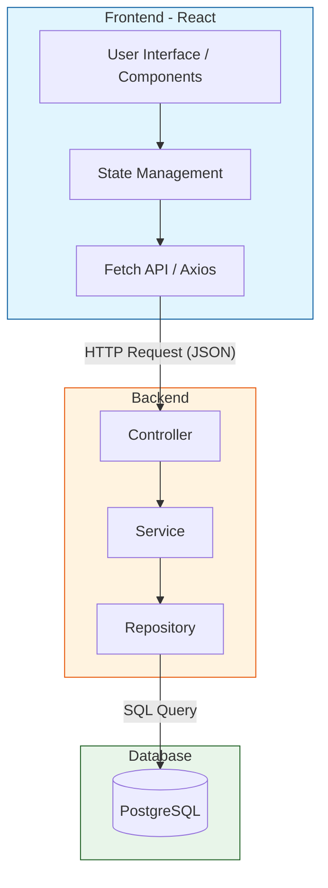

# Dashboard de Monitoramento de Clima

Este projeto é um sistema de monitoramento de clima que consome dados de uma API de meteorologia e exibe em um dashboard intuitivo.

## Arquitetura do Sistema

Abaixo está o diagrama de componentes que ilustra a interação entre o Frontend (React), o Backend (API) e o Banco de Dados (PostgreSQL).

## Tecnologias Utilizadas
- **Frontend:** React, Tailwind CSS
- **Backend:** [Inserir Tecnologia, ex: Node.js/Express]
- **Banco de Dados:** PostgreSQL