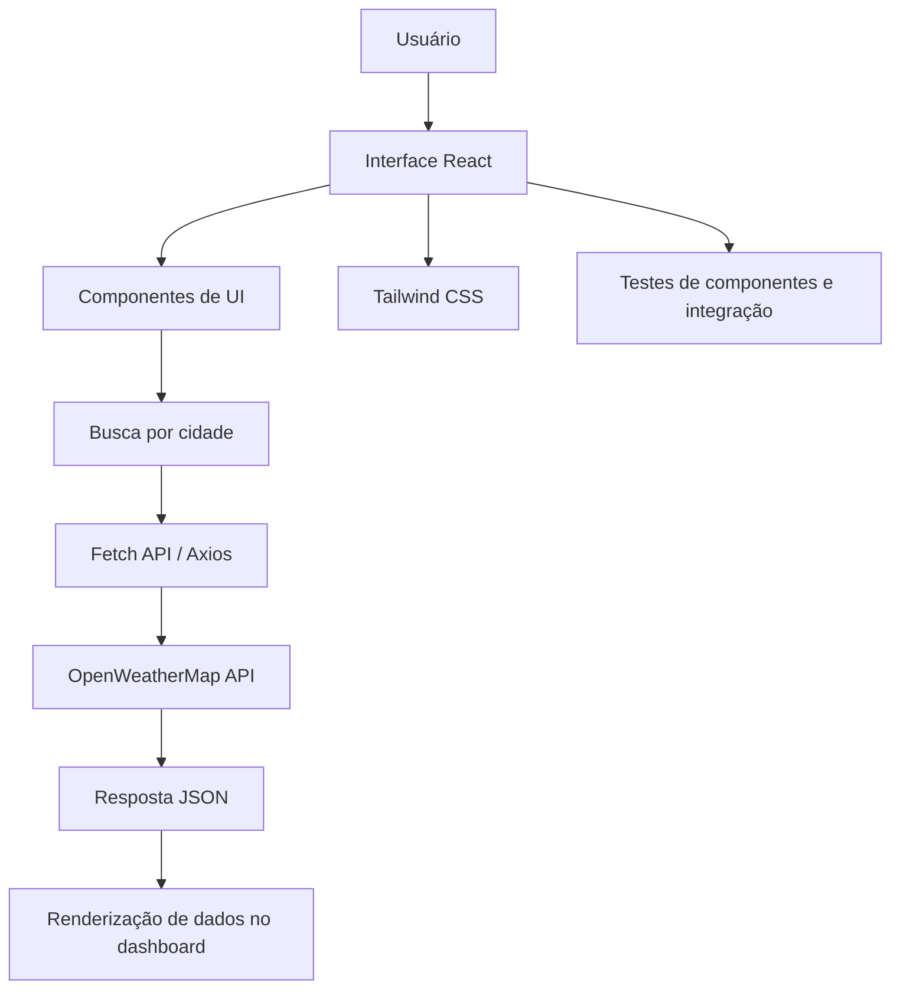
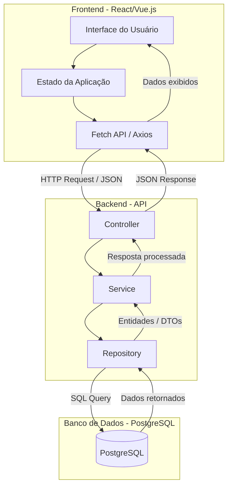

# Dashboard de Monitoramento de Clima

## Visão Geral

Este miniprojeto tem como objetivo desenvolver um Produto Mínimo Viável (MVP) de um dashboard de monitoramento de clima, utilizando uma interface web em React e consumindo dados de uma API externa de meteorologia, como a OpenWeatherMap.

A ideia central é demonstrar como a inteligência artificial pode apoiar as fases de planejamento, geração de código, testes, documentação e refinamento visual em um projeto de software pequeno, mas relevante e demonstrável.

## Objetivo do Projeto

Criar uma aplicação web frontend responsiva que permita:

- Buscar cidades por nome;
- Exibir as condições climáticas atuais;
- Mostrar informações como temperatura, umidade e sensação térmica;
- Apresentar uma previsão de curto prazo para a cidade selecionada;
- Oferecer uma interface simples, legível e visualmente agradável.

## Escopo do MVP

O projeto deve manter um escopo limitado e focado para viabilizar desenvolvimento e aprendizagem em um período razoável.

### Funcionalidades inclusas

- Busca por cidade;
- Card com dados climáticos atuais;
- Ícones e descrição do clima;
- Temperatura em °C;
- Umidade em %;
- Previsão para os próximos dias;
- Tratamento de erro para cidade não encontrada ou falha na API;
- Layout responsivo para desktop e mobile.

### Funcionalidades fora do escopo

- Autenticação de usuários;
- Persistência de dados em banco;
- Histórico de buscas salvo no backend;
- Múltiplos módulos de negócio;
- Integração com outros serviços externos além da API de clima.

## Tecnologias

- Frontend: React
- Estilização: Tailwind CSS
- Requisições HTTP: Fetch API ou Axios
- API externa: OpenWeatherMap (ou equivalente)
- Testes: React Testing Library + Jest

## Arquitetura do Sistema

O projeto é uma aplicação frontend que comunica diretamente com a API externa de clima. A arquitetura é simples, adequada ao objetivo de explorar o uso da IA em múltiplas etapas.

## Atividades de IA no Laboratório

Este projeto permite explorar a IA em diversas etapas do desenvolvimento:

- Geração de componentes de interface do usuário;
- Implementação da lógica de busca e consumo de API;
- Criação de testes para componentes e requisições;
- Sugestão de classes e ajustes de layout com Tailwind CSS;
- Refatoração de código para melhor legibilidade e manutenção;
- Geração de documentação técnica e instruções de uso.

## Fluxo de Mensagens

## Estrutura de Desenvolvimento Sugerida

- `src/components`: componentes da interface
- `src/pages`: telas principais
- `src/services`: funções de consumo da API
- `src/hooks`: lógicas reutilizáveis
- `src/tests`: testes automatizados
- `src/styles`: estilos globais e configurações do Tailwind

## Critérios de Aceitação

O MVP será considerado concluído quando:

- A aplicação consegue buscar clima de pelo menos uma cidade;
- Os dados principais são exibidos corretamente;
- A interface responde bem em telas menores;
- Há tratamento para falhas de requisição;
- Os testes cobrem os principais fluxos da aplicação;
- O código está organizado e documentado.

## Benefício do Projeto

Este miniprojeto é ideal para o laboratório porque combina:

- escopo limitado e claro;
- relevância prática;
- uso intenso de genAI em vários estágios da entrega;
- facilidade de teste;
- familiaridade tecnológica com React e JavaScript/TypeScript;
- possibilidade de demonstrar aprendizado em UI, integração e qualidade de software.

## Entregáveis Esperados

- Repositório com código funcional;
- README com instruções de uso;
- Interface de dashboard com dados de clima;
- Testes automatizados;
- Documentação resumida das decisões de implementação e uso da IA.

## Conclusão

O dashboard de monitoramento de clima é uma escolha adequada para este laboratório porque permite praticar os conceitos fundamentais de desenvolvimento de software com suporte da genAI, sem perder tempo com um projeto excessivamente complexo. Ele oferece um equilíbrio ideal entre simplicidade, aplicabilidade e potencial de experimentação com ferramentas inteligentes de desenvolvimento.